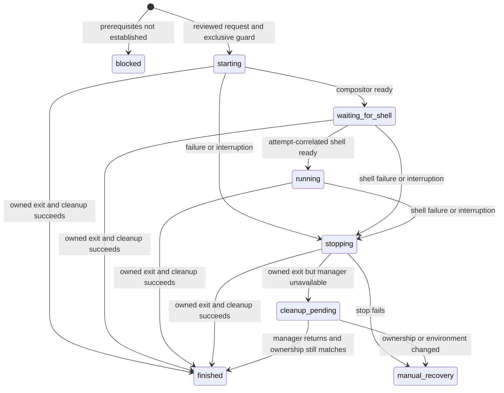

# Launcher lifecycle simulation

`desktopforge.lifecycle` is a pure model of proposed startup and cleanup behavior.
It does not read the host, call systemd, start processes, send signals, write files,
change environment variables or install anything. The plan embeds a static
`simulation_only` contract, not a runnable launcher or a runtime state snapshot.
All installation previews stay blocked.

## Scope and prerequisites

A model request identifies a session, a unique attempt token and an absolute
isolated `desktopforge/sessions/<session-id>/niri.kdl` path. Structural checks do
not validate a real path or file. The default request has neither config validation
nor hook review; both must be explicitly asserted in simulation inputs before
beginning. A static `preflight.status=observed` does not set those assertions.

The model refuses to begin when the user manager is unavailable, a session guard
is already held, environment ownership is already claimed, or the compositor is
active or uncertain. It never attempts to take over or stop another session.

Inputs are immutable dataclasses. `begin` and `advance` return new simulated state
and symbolic effect names. Effects have no command lines, adapters or executor.
The model uses neither clocks nor randomly generated IDs, making the same input
and event sequence deterministic.

## States and observations

Any active phase can require manual recovery if compositor or guard ownership is
lost. Exit before shell readiness records startup failure, never a completed
startup. A startup-failure event requests a stop and requires a later explicit exit
event before restoring environment. Repeated interruption during stopping does
not repeat the modeled stop request.

`READY`, `SHELL_READY` and `EXITED` events assert authoritative observations for the
same attempt in the model. They are not actual probes. In particular, a service
name, PID, process disappearance or successful launcher return alone does not
implement that correlation. Shell health checks and compositor stop
acknowledgements remain design work for a future runtime.

## Environment ownership

Only `NIRI_CONFIG` is modeled. Unrelated environment keys are outside the API and
cannot be changed by it. A slot holds a value or absence, an owner token and a
monotonic revision. Existing empty values are distinct from an unset variable.

A modeled start acquires the exclusive session guard, captures the prior slot,
publishes the isolated config value with its attempt token and a newer revision,
and requests compositor startup. Cleanup requires all of:

1. The attempt still owns the session guard.
2. Its compositor is confirmed stopped, with no new compositor owner.
3. The manager is available.
4. Current value, revision and owner exactly match the published slot.

Only then is the prior value restored (or the variable unset if originally
absent), using a newer revision, followed by releasing the guard. Comparing the
revision prevents a simulated change-away-and-back from being mistaken for an
untouched value. Duplicate cleanup after completion returns no further effects.

A manager outage after exit retains state in `cleanup_pending` for an explicit
retry. Changed ownership, a changed slot or an unconfirmed stop does not trigger
blind restoration or guard release: the result is `manual_recovery`. No manual
recovery commands are generated, and the model does not claim that the environment
has been rolled back in those cases.

## Runtime work still required

The guard, slot revisions and ownership tokens are modeled primitives. This code
does not establish an atomic implementation of them in a systemd user manager.
Likewise, the modeled initial guard/snapshot/publication sequence does not cover
real partial writes or IPC failure between those steps. Building an adapter by
simply running the symbolic effects would not satisfy this contract.

Before runnable launcher code or VM installation can be approved, design and test:

- A per-user exclusive guard with ownership and process identity checks, without
  conflicting with existing unmanaged Niri sessions.
- An environment strategy compatible with the installed `niri-session` behavior.
  Its broad imports and D-Bus behavior are not limited by this model. The contract
  cannot promise ownership of variables the launcher does not control.
- Reliable attempt-correlated compositor and shell readiness/exit observations.
- Partial startup/IPC failures, graceful signal forwarding, stop acknowledgement
  and timeout behavior. Timeout policy is not implemented here.
- Durable recovery after an uncatchable termination, machine crash or restart.
  The model is in-memory and cannot run cleanup after those events.
- Complete isolated Niri configuration, path validation and disposable VM tests
  that preserve existing sessions. These remain separate from lifecycle logic.

Tests exercise prior value/absence restoration, separate shell readiness,
startup failure, interruption, manager outages, concurrent attempts, foreign
ownership, changed revisions, stop failures, invalid paths/events and repeated
cleanup. Passing them validates the pure model, not a live Linux session.

## Native implementation follow-up

[Native runtime primitives](LAUNCHER_RUNTIME.md) now implement a real cooperating
per-user lease, unfinished-attempt markers, config descriptor pinning and direct
child control. They do not implement the model's shared-manager environment
revision semantics, runtime readiness or full session shutdown. There is no
adapter that executes these modeled effects against the installed desktop.

## Runnable candidate strategy

The [runnable launcher candidate](TRY_LAUNCHER.md) avoids shared-manager environment
publication entirely. The earlier snapshot/revision model remains a tested design
study, not an adapter executed by the candidate. Runtime shutdown instead checks
its uniquely owned service and cgroup. Graphical integration/VM validation is
still pending; the model's success states do not certify the candidate.
